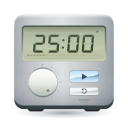

# AquaTimer

AquaTimer 是一款受 Mac OS X Tiger 启发的 macOS 桌面倒计时器。泡茶、做饭，或给手头的事留一段专注时间，都可以拨好时间，让它在桌面上数到零。

## 使用 AquaTimer

- 用滚轮拨分钟，也可以直接输入时、分、秒。计时过程中可以暂停、继续或重置。
- 点击窗口左上角的绿灯收起控制区，让桌面上只留一块显示剩余时间的 LCD。再点一次就能展开。
- 在「偏好设置」里选择提示音、调节音量，或开启 macOS 通知。也可以设置每次打开时的默认时长，或者沿用上次的时长。

## 设计灵感

主窗口像一台放在桌上的电子计时器。拉丝金属外壳围住带玻璃反光的 LCD，没亮起的数字笔段在底色里仍隐约可见。偏好设置换成了 Tiger 常见的浅色细条纹，配上有高光的玻璃按钮。

如果你想看看这些细节是怎么设计的，可以翻阅 [Aqua 设计稿](design/)，其中保留了窗口、控件、LCD 和应用图标的原稿与预览。

## 运行

AquaTimer 面向 macOS 14 及以上版本。可以用 Xcode 打开 `AquaTimer.xcodeproj`，选择 `AquaTimer` 方案后点击运行。

## 许可证

AquaTimer 使用 [MIT 许可证](LICENSE)。LCD 数字使用的 DSEG 字体遵循 [SIL Open Font License 1.1](AquaTimer/Resources/Fonts/DSEG-LICENSE.txt)。
