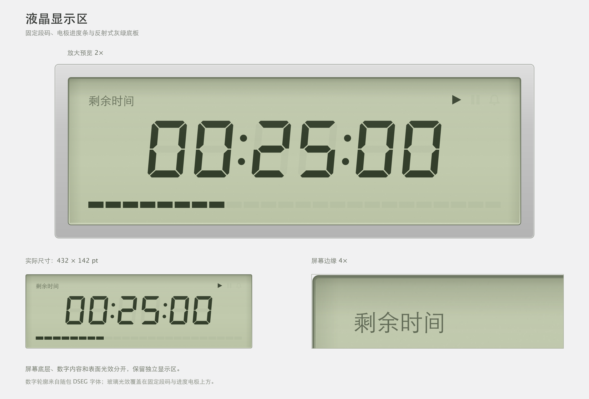

# AquaTimer 设计稿

AquaTimer 把 Mac OS X Tiger 的 Aqua 风格用在一台桌面电子计时器上。主窗口用拉丝金属围住液晶屏，分钟旋钮和玻璃按钮让设定、开始和暂停各有一个看得见的操作部件。偏好设置换成浅色细条纹，按钮也换成适合这个底色的灰白玻璃。

| 分类 | 可以看到什么 |
| --- | --- |
| [窗口](window/) | 拉丝金属从两侧向中央提亮，红黄绿三颗按钮有悬停、按下和窗口失焦等状态。标题栏还画了偏好设置的工具栏开关。[拉丝金属](window/brushed-metal.svg) · [红绿灯](window/aqua-window-buttons.svg) · [工具栏开关](window/aqua-toolbar-toggle.svg) |
| [控件](controls/) | 分钟旋钮靠面盘上的凹点暗示拨动，主窗口的操作按钮和偏好设置的「试听」按钮各有一套玻璃高光。这里也收录了输入框、下拉菜单、单选按钮、复选框和音量滑块。[分钟旋钮](controls/aqua-minute-dial.svg) · [主窗口按钮](controls/aqua-action-buttons.svg) · [试听按钮](controls/aqua-preview-button.svg) |
| [液晶显示](display/) | 除了亮起的数字，底色里还能看见未点亮的笔段。下方的进度格和屏幕表面的反光都画在同一块 LCD 上。[液晶显示原稿](display/lcd-display.svg) |
| [偏好设置](settings/) | 提醒设置页用一个小扬声器图标标示声音与通知相关选项。[扬声器图标](settings/aqua-settings-speaker.svg) |
| [应用图标](icon/) | 把计时器画成一台完整的小设备。机身、屏幕、按键和玻璃等部件可以分开查看，共有九层。[图标原稿](icon/AquaTimer.svg) · [分层素材](icon/elements/) |

如果原稿旁有 PNG，可以直接预览。许多控件稿把原尺寸和放大细节放在同一张图上，可以先看它在窗口里占多少空间，再放大看边缘和高光。

[返回 AquaTimer 项目介绍](../README.md)
